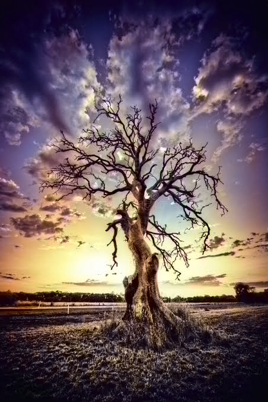
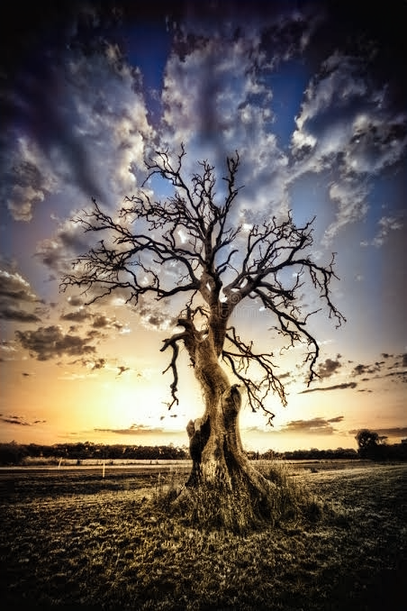

# AI Image Colorization — Reproduction Project

## Overview

This repository documents my reproduction of **Colorful Image Colorization**, the open-source image colorization project by Richard Zhang and collaborators. I used the released **ECCV 2016** and **SIGGRAPH 2017** pretrained models to generate plausible colors for grayscale images, inspect their outputs, and document a workflow that classmates can repeat.

**This is a reproduction/inference exercise, not training from scratch.** The model designs, code, and pretrained weights originate from the researchers credited below.

- **My repository:** https://github.com/RC0619/colorization-project
- **Original implementation:** https://github.com/richzhang/colorization
- **Tested Python version:** **3.8.20**
- **Working environment:** Linux, Visual Studio Code

## What I did

1. Cloned and inspected the original repository.
2. Configured a Python environment and installed dependencies.
3. Ran the released image colorization demo with pretrained models.
4. Generated and saved ECCV 2016 and SIGGRAPH 2017 results.
5. Compared the results and documented the steps for peer reproduction.

## How the models work

A grayscale image does not contain its original colors. The models predict *plausible* colors based on patterns learned during training. Two different models can assign different colors to the same input, and neither result is guaranteed to match the original scene.

| Model | Paper | Purpose |
| --- | --- | --- |
| ECCV 2016 | *Colorful Image Colorization* | Automatic image colorization |
| SIGGRAPH 2017 | *Real-Time User-Guided Image Colorization with Learned Deep Priors* | Colorization with support for user guidance and automatic operation |

## Reproduce the project

The commands below assume **Linux/macOS Bash or Zsh**, and that you start outside the repository. Windows users need to adapt the environment activation command.

### 1. Clone

```bash
git clone https://github.com/RC0619/colorization-project.git
cd colorization-project
pwd
ls
```

Confirm that `demo_release.py`, `requirements.txt`, `imgs/`, and `colorizers/` exist. If your copy differs, inspect the files before proceeding.

### 2. Use Python 3.8.20

This is the Python version used for my reproduction. The following example uses [`uv`](https://docs.astral.sh/uv/), **if it is already installed**:

```bash
uv python install 3.8.20
uv venv --python 3.8.20 .venv
source .venv/bin/activate
python --version
which python
```

Expected Python version:

```text
Python 3.8.20
```

**Alternative:** If Python 3.8.20 is already installed and `uv` is unavailable, create a virtual environment with the matching interpreter (the executable name may vary by machine):

```bash
python3.8 -m venv .venv
source .venv/bin/activate
python --version
```

If an existing `.venv` belongs to another project or Python version, **do not overwrite it blindly**. Create a different environment name, such as `.venv38`, and activate that one instead.

### 3. Install dependencies

With the environment activated:

```bash
python -m pip install -r requirements.txt
python -m pip check
```

If using a `uv` environment where pip is not installed, use:

```bash
uv pip install -r requirements.txt
uv pip check
```

Check important imports:

```bash
python -c "import torch; print('PyTorch:', torch.__version__)"
python -c "import cv2; print('OpenCV:', cv2.__version__)"
```

**Dependency reproducibility note:** Python 3.8.20 is confirmed for this reproduction, but the precise working versions of every package have not been independently verified in this README. If dependency resolution fails, record the full error rather than installing random package versions.

### 4. Check input and model weights

Verify the example image:

```bash
ls -lh imgs/ansel_adams3.jpg
```

The pretrained models require compatible weight files. In some versions of the original implementation, the weights are downloaded automatically by the colorizer-loading functions. This depends on the code and network access; it should not be assumed to work offline.

Inspect the model-loading logic:

```bash
ls colorizers
grep -n "pretrained" colorizers/eccv16.py colorizers/siggraph17.py
```

If the first run downloads weights, wait for the download to finish. If a download fails, consult the [original repository](https://github.com/richzhang/colorization) and use only weights intended for the corresponding model.

### 5. Run inference

From the repository root, with the virtual environment active:

```bash
python demo_release.py -i imgs/ansel_adams3.jpg
```

This is the demo command used in my reproduction. It processes the specified image using the released colorization implementation. **Whether the script displays images, saves them, or both depends on the current `demo_release.py` source.**

To inspect the command-line arguments and saving behavior:

```bash
python demo_release.py --help
grep -nE 'savefig|imsave|imwrite|save\(' demo_release.py
```

If `--help` is not implemented, inspect the script directly:

```bash
sed -n '1,240p' demo_release.py
```

### 6. Verify outputs

The two saved images from my reproduction are named:

- `saved_eccv16.png`
- `saved_siggraph17.png`

Check whether they are present in the repository root:

```bash
ls -lh saved_eccv16.png saved_siggraph17.png
```

If these files are absent after a fresh run, **do not assume the model failed**: the demo may only display the results. Find generated image files with:

```bash
find . -type f \( -iname '*.png' -o -iname '*.jpg' \)
```

Inspect the script's output variables and add an appropriate saving step if required. The exact saving code must match the variables and image types actually produced by your version of `demo_release.py`.

## Results

### ECCV 2016



### SIGGRAPH 2017



> **Note:** These image links render on GitHub only if the PNG files have been committed at the repository root with exactly these names. If they are in a different folder, update the relative paths above.

### What to compare

- **Plausibility:** Do the predicted colors look natural?
- **Consistency:** Are similar regions colored consistently?
- **Saturation:** Are colors muted or vivid?
- **Mistakes:** Are any objects assigned implausible colors?

Because the original colors are unknown from the grayscale input alone, visual plausibility is not proof of ground-truth accuracy.

## Troubleshooting

Run commands from the **repository root**, and use the **same active Python environment** for installation and inference.

### A. `python` is not Python 3.8.20

**Symptom:** `python --version` shows 3.10, 3.11, or another version.

```bash
python --version
which python
```

Activate the correct environment, or create a separate Python 3.8.20 environment:

```bash
uv python install 3.8.20
uv venv --python 3.8.20 .venv38
source .venv38/bin/activate
python --version
```

Do not assume installing Python changes the interpreter used by an existing terminal or virtual environment.

### B. `uv: command not found`

**Cause:** `uv` is not installed or not on `PATH`.

**Fix:** Use an already installed Python 3.8 interpreter with `python3.8 -m venv .venv`, or follow the [official uv installation guide](https://docs.astral.sh/uv/getting-started/installation/). On managed university computers, avoid system-level installation without permission.

### C. `ModuleNotFoundError` (for example, `torch`, `cv2`, `skimage`)

**Cause:** Missing dependencies or packages installed into the wrong interpreter.

```bash
which python
python -m pip --version
python -m pip install -r requirements.txt
python -m pip check
```

If the virtual environment was created by `uv` without pip, run `uv pip install -r requirements.txt` instead. Read the **exact missing module name** before changing packages.

### D. `No matching distribution found` / dependency conflict

**Cause:** A package version may not support Python 3.8, your operating system, or the installed architecture.

```bash
python --version
python -m pip check
python -m pip list
```

Inspect `requirements.txt` and the failing package's compatibility information. Do not upgrade all dependencies blindly: older research projects can depend on older APIs.

### E. `FileNotFoundError` for an input image

**Cause:** Wrong working directory, misspelled filename, or missing file.

```bash
pwd
ls
ls imgs
ls -lh imgs/ansel_adams3.jpg
```

Then run the demo from the repository root:

```bash
python demo_release.py -i imgs/ansel_adams3.jpg
```

Linux filenames are case-sensitive.

### F. Pretrained weights cannot be downloaded

**Possible causes:** Network restrictions, unavailable download URL, permission issues, or an incomplete cached download.

```bash
grep -n "pretrained" colorizers/eccv16.py colorizers/siggraph17.py
```

Read the **complete traceback** to find the download URL or cache location. Check the original repository's instructions. Use only official or trusted matching weights; do not rename unrelated `.pth` files to bypass an error.

### G. CUDA / GPU errors

Check whether PyTorch can use CUDA:

```bash
python -c "import torch; print('CUDA available:', torch.cuda.is_available())"
```

If `False`, the environment has no usable CUDA device. The demo may run on CPU, but confirm whether the script explicitly requires a GPU. Do not force `.cuda()` when CUDA is unavailable. CPU inference may be slower.

### H. The script runs but no PNG files appear

**Cause:** The demo may display results without writing them to disk, or may save them elsewhere.

```bash
grep -nE 'savefig|imsave|imwrite|save\(' demo_release.py
find . -type f \( -iname '*.png' -o -iname '*.jpg' \)
```

If no save operation exists, add one **only after checking** the actual output variables and image data types in the script. Avoid copying a saving snippet that assumes variable names which do not exist.

### I. README result images are broken on GitHub

Check local filenames:

```bash
ls -lh saved_eccv16.png saved_siggraph17.png
```

Check whether Git tracks them:

```bash
git ls-files saved_eccv16.png saved_siggraph17.png
```

If files exist locally but are not tracked, add and commit them in **your own repository**:

```bash
git add saved_eccv16.png saved_siggraph17.png
git commit -m "Add colorization results"
git push
```

If the files are in a subfolder, fix the Markdown links instead.

### J. `zsh: bad pattern: ^[[200~...`

**Cause:** Pasted terminal control characters were included in the command.

**Fix:** Press **Ctrl+C**, clear the input, and type the command again. Do not copy terminal prompt symbols or invisible characters.

### K. `Permission denied` / `externally-managed-environment`

Install packages inside a virtual environment instead of system Python:

```bash
source .venv/bin/activate
python -m pip install -r requirements.txt
```

If using a `uv` environment without pip, use `uv pip install -r requirements.txt`. Avoid `sudo pip install` and avoid `--break-system-packages` for this project.

### L. `git clone` says the directory already exists

```bash
ls
cd colorization-project
git status
```

If the directory is already your clone, use it instead of cloning again. Do not delete a directory containing uncommitted work.

### M. `git push` is rejected / remote has new commits

Check the branch and working tree:

```bash
git status
git branch --show-current
git remote -v
```

If you edited README directly on GitHub, the remote may be ahead of your local branch. **Commit or safely stash any local changes first**, then integrate the remote changes:

```bash
git pull --rebase
```

Resolve any conflicts before pushing. Avoid `git push --force` for routine README edits.

### N. VS Code Explorer shows “NO FOLDER OPENED”

The terminal can be inside a Git repository even when the VS Code Explorer has not opened it. Use **File → Open Folder** and select your `colorization-project` folder. This does not require cloning again.

### O. How to collect diagnostic information

If reproduction fails, share the **exact command and full error output**. These commands help identify environment and path issues:

```bash
pwd
python --version
which python
python -m pip check
git status
ls -lh demo_release.py requirements.txt imgs/ansel_adams3.jpg
```

Never share passwords, private tokens, or credentials in screenshots or logs.

## Peer reproduction checklist

- [ ] Clone the repository successfully.
- [ ] Use Python **3.8.20**.
- [ ] Activate a virtual environment.
- [ ] Install dependencies without unresolved conflicts.
- [ ] Confirm that the input image exists.
- [ ] Load both pretrained models successfully.
- [ ] Run `demo_release.py` without an error.
- [ ] Inspect ECCV 2016 and SIGGRAPH 2017 outputs.
- [ ] Confirm where and how output images are saved.
- [ ] Record any differences from the documented workflow.

## Limitations and reflection

This reproduction uses **pretrained weights**, so it does not reproduce the original model training process. Colors are predictions, not recoveries of known original colors. Results may vary with image content, software dependencies, and model availability.

The project helped me understand how to navigate an existing research repository, manage Python environments, run pretrained models, compare generated images, and document troubleshooting steps for other students.

## Credits and references

The original models, code, and research belong to their authors. This repository is a personal reproduction and documentation exercise.

- **Original source:** [richzhang/colorization](https://github.com/richzhang/colorization)
- Zhang, R., Isola, P., and Efros, A. A. (2016). *Colorful Image Colorization*. ECCV.
- Zhang, R., Zhu, J.-Y., Isola, P., Geng, X., Lin, A. S., Yu, T., and Efros, A. A. (2017). *Real-Time User-Guided Image Colorization with Learned Deep Priors*. ACM Transactions on Graphics (SIGGRAPH).

Please consult the original repository for its licensing terms, code provenance, and model-specific details.

